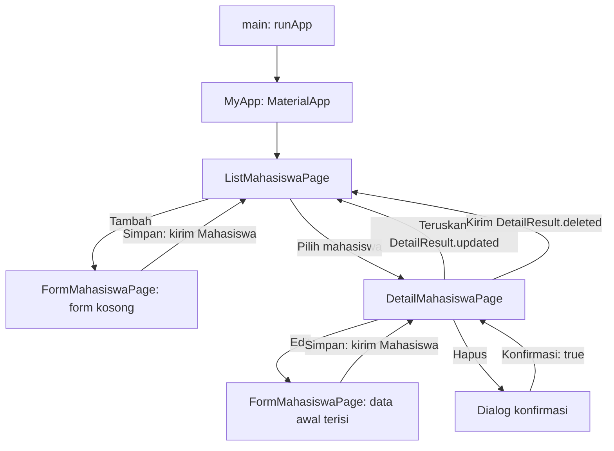
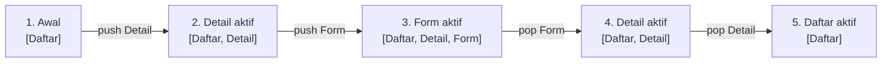
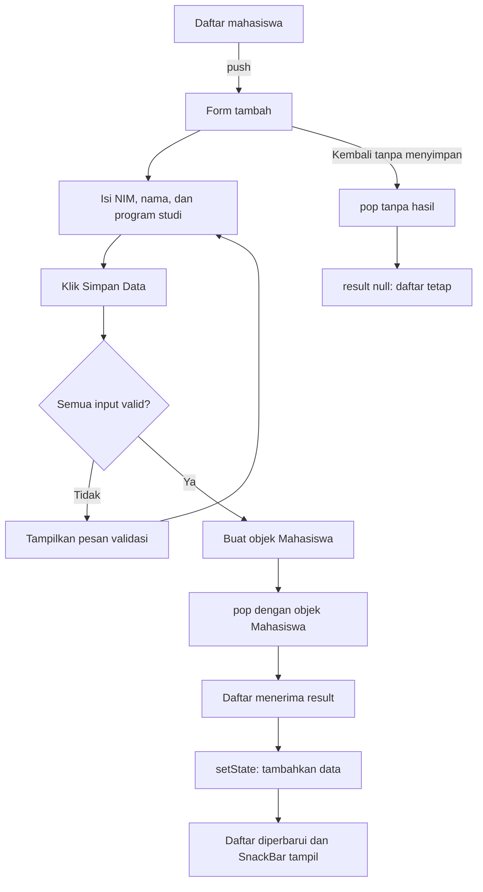
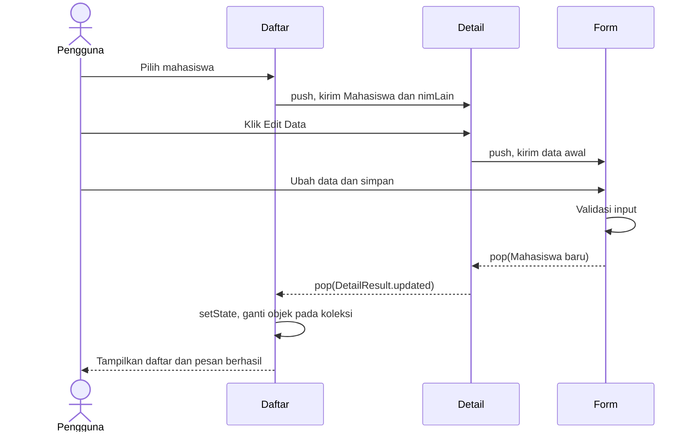
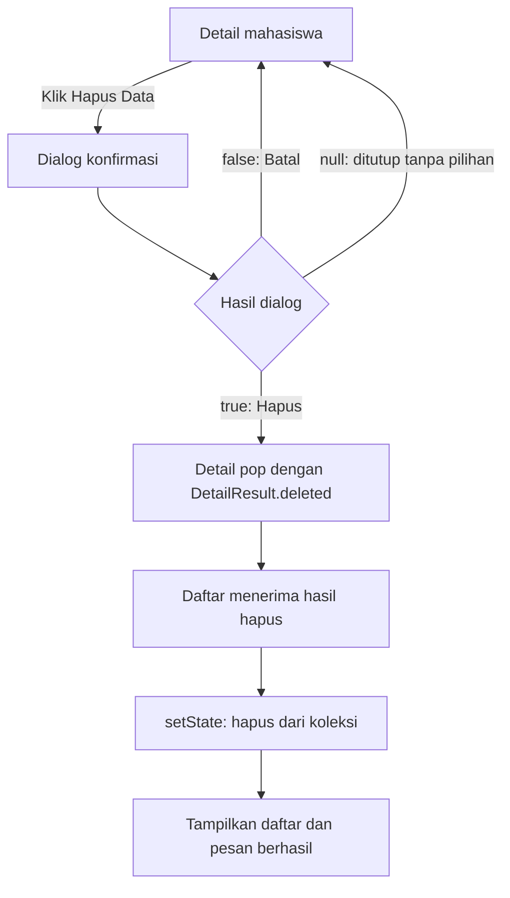
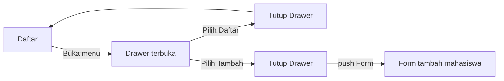
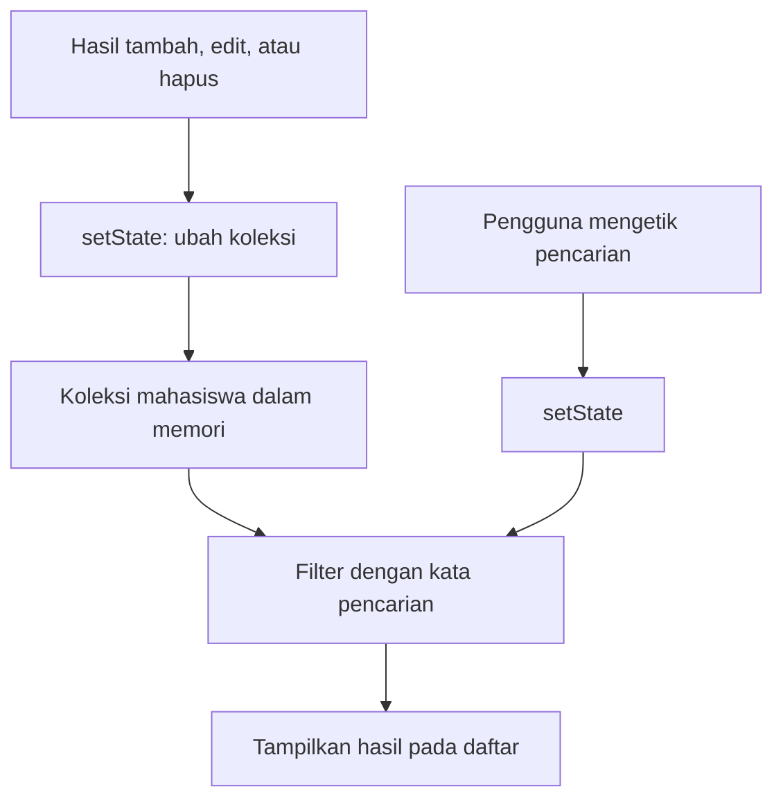

# Pembelajaran Navigasi Flutter: CRUD Mahasiswa

Dokumentasi ini menjelaskan navigasi melalui implementasi aplikasi pada proyek ini. Diagram menggunakan MermaidJS; buka file dengan penampil Markdown yang mendukung blok `mermaid` agar diagram tampil.

## 1. Tujuan pembelajaran

Setelah mempelajari contoh ini, mahasiswa diharapkan mampu:

- Menjelaskan tumpukan halaman dan prinsip Last In, First Out (LIFO).
- Membuka dan menutup halaman menggunakan `Navigator`.
- Mengirim objek ke halaman tujuan melalui konstruktor.
- Mengembalikan hasil dari halaman menggunakan `Navigator.pop`.
- Menghubungkan hasil navigasi dengan perubahan data dan tampilan.
- Memahami navigasi Drawer dan dialog konfirmasi.

## 2. Struktur aplikasi

| File | Tanggung jawab |
| --- | --- |
| `lib/main.dart` | Menjalankan aplikasi dan menetapkan halaman awal. |
| `lib/models/mahasiswa.dart` | Model dengan atribut NIM, nama, dan program studi. |
| `lib/pages/list_mahasiswa_page.dart` | Menyimpan daftar dalam memori, mencari data, dan menerima hasil CRUD. |
| `lib/pages/form_mahasiswa_page.dart` | Form tambah/edit, validasi, dan pengembalian objek mahasiswa. |
| `lib/pages/detail_mahasiswa_page.dart` | Menampilkan detail, membuka form edit, dan meminta konfirmasi hapus. |



Pada implementasi ini, setelah edit berhasil, halaman detail langsung ditutup dan pengguna kembali ke daftar. Jika form edit dibatalkan, pengguna tetap berada di detail.

## 3. Navigator dan prinsip LIFO

`Navigator` mengelola tumpukan rute. Rute adalah representasi halaman atau tampilan navigasi. Halaman yang terakhir dibuka menjadi halaman aktif.

- `push`: menambahkan rute baru ke atas tumpukan.
- `pop`: menutup rute aktif dan memperlihatkan rute sebelumnya.
- `MaterialPageRoute`: rute yang membangun halaman dengan transisi Material.
- `BuildContext`: digunakan untuk menemukan Navigator yang menangani navigasi.

Contoh membuka detail, lalu form edit:



Bagian paling kanan dalam notasi `[Daftar, Detail, Form]` adalah bagian atas tumpukan. Pada alur simpan edit, dua operasi `pop` dijalankan bertahap: form mengembalikan `Mahasiswa`, lalu detail mengembalikan `DetailResult` ke daftar.

## 4. Membuka halaman dan mengirim data

Cuplikan berikut berasal dari fungsi `_detail` pada halaman daftar:

```dart
final result = await Navigator.push<DetailResult>(
  context,
  MaterialPageRoute(
    builder: (_) => DetailMahasiswaPage(
      mahasiswa: mahasiswa,
      nimLain: _nimTerpakai(mahasiswa),
    ),
  ),
);
```

Objek `mahasiswa` dikirim melalui konstruktor. Halaman detail menerima objek tersebut untuk menampilkan nama, NIM, dan program studi. `nimLain` berisi NIM mahasiswa lain untuk memvalidasi form edit.

`Navigator.push<DetailResult>` menghasilkan `Future<DetailResult?>`. `await` menunggu rute detail ditutup dan hasilnya dikembalikan; antarmuka tetap dapat menerima interaksi selama penantian tersebut.

Tipe `DetailResult?` berarti hasil boleh `null`, misalnya ketika pengguna menekan tombol kembali tanpa melakukan perubahan.

## 5. Mengembalikan hasil: alur tambah mahasiswa

Halaman daftar membuka form kosong dan menunggu objek baru:

```dart
final result = await Navigator.push<Mahasiswa>(
  context,
  MaterialPageRoute(
    builder: (_) => FormMahasiswaPage(
      nimTerpakai: _nimTerpakai(),
    ),
  ),
);

if (!mounted || result == null) return;
setState(() => _mahasiswa.add(result));
_pesan('Data mahasiswa berhasil ditambahkan');
```

Pada form, tombol simpan menjalankan validasi terlebih dahulu:

```dart
void _simpan() {
  if (!_formKey.currentState!.validate()) return;
  Navigator.pop(
    context,
    Mahasiswa(
      nim: _nim.text.trim(),
      nama: _nama.text.trim(),
      prodi: _prodi.text.trim(),
    ),
  );
}
```

Argumen kedua `Navigator.pop` adalah hasil yang diterima oleh `await Navigator.push` pada halaman sebelumnya. Form membuat objek, sedangkan halaman daftar melakukan penambahan ke koleksi.



Validasi menolak kolom kosong, termasuk input yang hanya berisi spasi. NIM harus unik; pembandingan NIM menggunakan huruf kecil agar tidak membedakan kapitalisasi.

## 6. Alur baca detail dan edit mahasiswa

Membaca detail hanya mengirim objek dari daftar ke detail. Data pada koleksi tidak berubah karena halaman detail dibuka.

Form yang sama dipakai untuk tambah dan edit:

| Kondisi | Tampilan form |
| --- | --- |
| `mahasiswa == null` | Judul Tambah Mahasiswa, kolom kosong. |
| `mahasiswa != null` | Judul Edit Mahasiswa, kolom terisi data awal. |

NIM milik mahasiswa yang sedang diedit dikecualikan dari daftar NIM terpakai. Dengan demikian, menyimpan edit tanpa mengganti NIM tetap diperbolehkan.

Pada halaman detail, fungsi `_edit` menerima hasil form dan meneruskannya:

```dart
final result = await Navigator.push<Mahasiswa>(
  context,
  MaterialPageRoute(
    builder: (_) => FormMahasiswaPage(
      mahasiswa: widget.mahasiswa,
      nimTerpakai: widget.nimLain,
    ),
  ),
);

if (!mounted || result == null) return;
Navigator.pop(context, DetailResult.updated(result));
```



Objek mahasiswa memiliki atribut `final`, sehingga edit menghasilkan objek baru. Halaman daftar mengganti objek lama pada indeks yang sama. Indeks dicari dari koleksi `_mahasiswa`, bukan dari indeks hasil pencarian, agar mahasiswa yang benar tetap diperbarui saat daftar sedang difilter.

## 7. Alur hapus dan dialog konfirmasi

`showDialog<bool>` menampilkan dialog dan menghasilkan `Future<bool?>`. Pilihan pengguna dikembalikan melalui `Navigator.pop` di dalam dialog:

```dart
// Tombol Batal pada dialog:
Navigator.pop(context, false);

// Tombol Hapus pada dialog:
Navigator.pop(context, true);
```

`context` pada contoh di atas berasal dari `builder` dialog. Operasi tersebut menutup dialog, kemudian fungsi `_hapus` melanjutkan pemeriksaan hasil:

```dart
if (!mounted || confirmed != true) return;
Navigator.pop(context, const DetailResult.deleted());
```

Pemeriksaan `confirmed != true` mencakup pilihan Batal (`false`) dan dialog yang ditutup tanpa pilihan (`null`). Hanya hasil `true` yang meneruskan permintaan hapus ke daftar.



## 8. Membedakan batal, edit, dan hapus

`DetailResult` membuat hasil navigasi detail memiliki makna yang jelas:

```dart
class DetailResult {
  final Mahasiswa? mahasiswa;
  const DetailResult.updated(Mahasiswa this.mahasiswa);
  const DetailResult.deleted() : mahasiswa = null;
}
```

| Hasil dari halaman detail | Makna | Aksi daftar |
| --- | --- | --- |
| `result == null` | Kembali tanpa perubahan. | Tidak mengubah data. |
| `result != null` dan `result.mahasiswa != null` | Edit berhasil. | Mengganti data lama. |
| `result != null` dan `result.mahasiswa == null` | Hapus dikonfirmasi. | Menghapus data lama. |

Hasil `null` dari navigasi berbeda dengan objek `DetailResult.deleted()` yang atribut `mahasiswa`-nya `null`. Perbedaan ini mencegah tombol kembali dianggap sebagai perintah hapus.

## 9. Drawer sebagai pemicu navigasi

Drawer menyediakan dua menu: Daftar Mahasiswa dan Tambah Mahasiswa.

```dart
onTap: () {
  Navigator.pop(context);
  _tambah();
},
```

Pada menu tambah, `Navigator.pop(context)` menutup Drawer yang sedang terbuka. Setelah itu, `_tambah()` membuka form. Menu daftar cukup menutup Drawer karena pengguna sudah berada di halaman daftar.



## 10. Hubungan navigasi, state, dan pencarian

Navigasi menentukan halaman yang terlihat. Perubahan koleksi terjadi ketika halaman daftar menerima hasil navigasi dan menjalankan `setState`.

Pencarian tidak membuka halaman baru. Perubahan teks memicu pembangunan ulang tampilan dan penyaringan `_mahasiswa` berdasarkan nama, NIM, atau program studi.



Kata pencarian tetap berlaku setelah CRUD. Jika data baru atau hasil edit tidak cocok dengan kata pencarian aktif, data tersebut tidak terlihat sampai pencarian diubah atau dibersihkan.

Setelah operasi `await`, kode memeriksa `mounted` untuk memastikan State masih terpasang sebelum menggunakan `context` atau memanggil `setState`. Pemeriksaan `result == null` menghentikan perubahan ketika pengguna membatalkan navigasi.

Controller form dan pencarian dibersihkan dalam `dispose()` ketika State dilepas.

## 11. Basic routing, named routing, dan navigasi UI

Materi awal membahas tiga pendekatan. Status penggunaannya dalam proyek ini:

| Pendekatan | Ide | Penggunaan pada proyek |
| --- | --- | --- |
| Basic routing | Membuka widget tujuan melalui `MaterialPageRoute`. | Digunakan untuk tambah, detail, dan edit. |
| Named routing | Membuka rute melalui nama yang didaftarkan. | Belum diterapkan. |
| Navigasi UI | Menu seperti Drawer atau tab menjadi pemicu perpindahan tampilan. | Drawer diterapkan; BottomNavigationBar belum diterapkan. |

Contoh tambahan berikut adalah ilustrasi named routing, bukan kode yang sedang dipakai di proyek:

```dart
MaterialApp(
  initialRoute: '/',
  routes: {
    '/': (_) => const ListMahasiswaPage(),
    '/contoh': (_) => const Scaffold(
      body: Center(child: Text('Halaman contoh')),
    ),
  },
);

// Dipanggil dari widget di bawah MaterialApp:
Navigator.pushNamed(context, '/contoh');
```

Nama rute menyederhanakan penyebutan tujuan. Data yang dibutuhkan form dan detail tetap harus disiapkan; pada proyek ini, konstruktor langsung membuat kebutuhan data setiap halaman mudah dilihat.

BottomNavigationBar dapat memilih konten berdasarkan indeks tab. Jika hanya mengganti indeks melalui `setState`, perpindahan tab tersebut tidak menambahkan rute ke tumpukan Navigator. Drawer dan BottomNavigationBar adalah komponen antarmuka; perilaku navigasinya ditentukan oleh kode yang dijalankan ketika menu dipilih.

## 12. Latihan dan pengamatan

Jalankan aplikasi:

```sh
flutter pub get
flutter run
```

Lakukan pengamatan berikut secara berurutan:

1. Buka form tambah lalu tekan kembali. Perhatikan bahwa jumlah mahasiswa tidak berubah.
2. Simpan form kosong. Perhatikan pesan validasi dan bahwa form tetap terbuka.
3. Tambahkan mahasiswa dengan NIM baru. Perhatikan bahwa form ditutup dan daftar bertambah.
4. Coba gunakan NIM yang sudah terdaftar. Perhatikan bahwa penyimpanan ditolak.
5. Buka detail lalu edit nama tanpa mengganti NIM. Perhatikan bahwa setelah simpan, pengguna kembali ke daftar.
6. Buka form edit lalu tekan kembali. Perhatikan bahwa pengguna kembali ke detail tanpa perubahan.
7. Pilih hapus lalu Batal. Perhatikan bahwa detail tetap terbuka dan data tetap ada.
8. Konfirmasi hapus. Perhatikan bahwa pengguna kembali ke daftar dan data berkurang.
9. Cari mahasiswa lalu edit datanya. Amati hasil filter yang dihitung ulang setelah edit.
10. Mulai ulang aplikasi. Perhatikan bahwa data awal kembali karena penyimpanan masih dalam memori.

Pertanyaan diskusi:

- Mengapa form mengembalikan objek melalui `pop`, lalu halaman daftar yang mengubah koleksi?
- Apa perbedaan `result == null` dan `result.mahasiswa == null`?
- Mengapa edit yang berhasil menutup dua halaman secara bertahap?
- Mengapa pencarian tidak membutuhkan `Navigator.push`?
- Apa yang perlu berubah jika setelah edit pengguna ingin tetap melihat halaman detail?

## 13. Verifikasi dan batas implementasi

Jalankan pemeriksaan proyek:

```sh
flutter analyze
flutter test
```

Pengujian widget pada `test/widget_test.dart` mencakup alur tambah, detail, edit, hapus, pembatalan hapus, validasi input, NIM duplikat, dan pencarian.

Aplikasi ini menggunakan data contoh dalam memori, tanpa database atau backend. Navigasi mengembalikan hasil antar halaman; navigasi sendiri tidak menyimpan data secara permanen. Penyimpanan permanen dapat dijadikan pengembangan berikutnya setelah alur navigasi dipahami.
